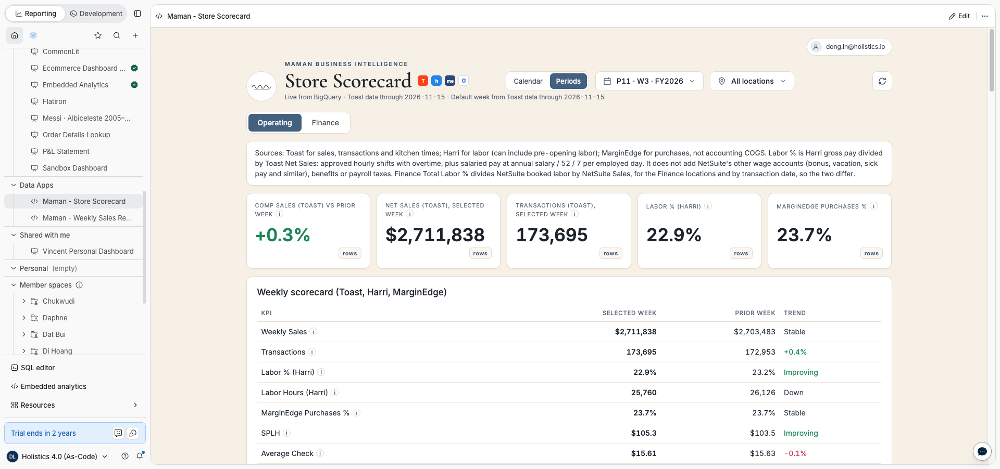
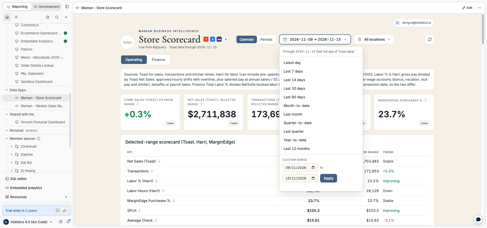
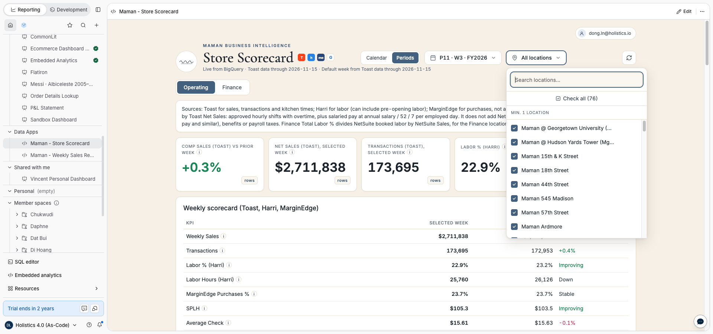
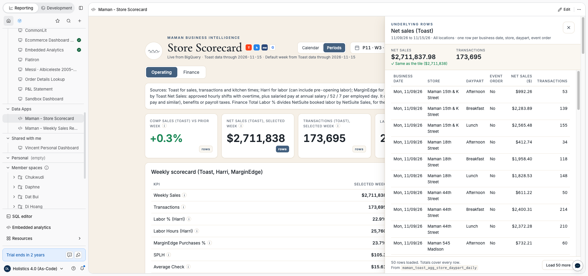
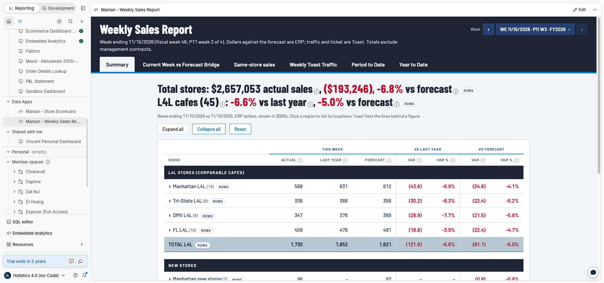
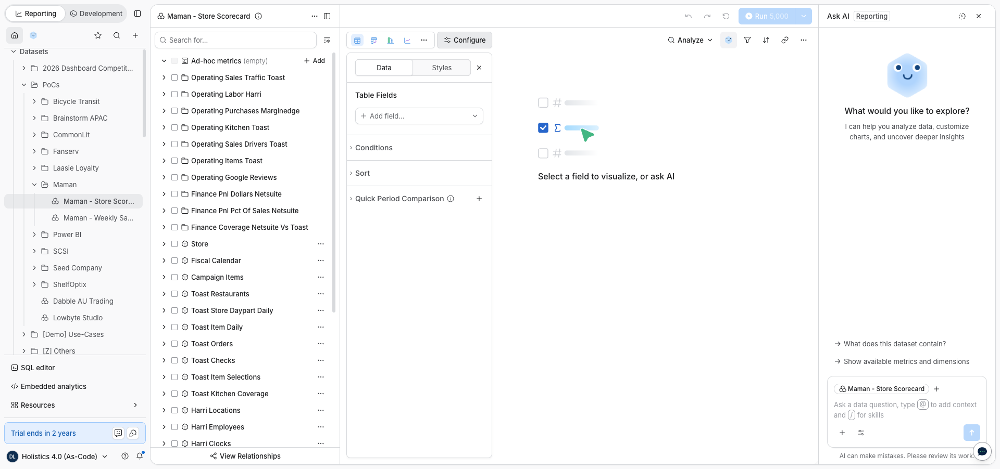
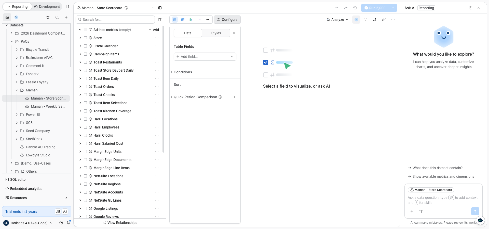
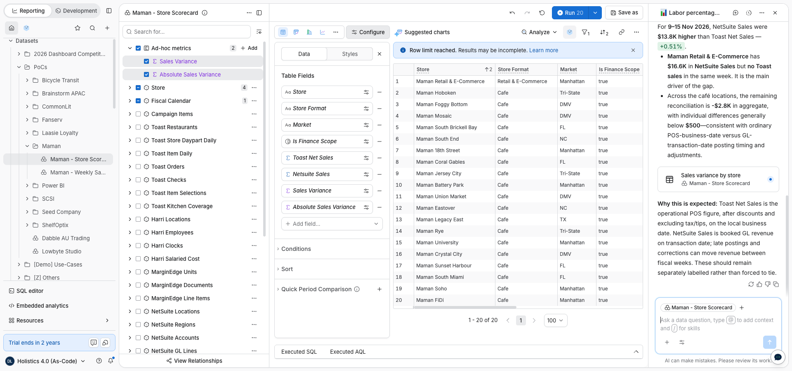

# Maman demo guide

How to walk Maman through the two data apps, the dataset and Holistics AI. Each step has a screenshot of what you should see.

## About the data

Say this up front: every number in the demo is generated mock data, not Maman's figures.

- **Tables:** we rebuilt the curated tables Maman described (Toast, Harri, MarginEdge, NetSuite, Google Business Profile, Datarails) in our own BigQuery, with the same table names and grain.
- **Columns:** Maman shared table names and grain only, no columns or rows. We inferred the columns from their KPI definitions and their two reports (the Store Scorecard and Ryan's weekly sales report).
- **Values:** store names, markets and opening dates follow Ryan's report. Every amount is generated to behave like their business (openings, closures, payroll booked after the week), and no per-store figure was copied from their reports.
- **Forecast:** a mock stand-in. Ryan's forecast is not in their warehouse.

With read access to their curated datasets, the same models, metrics and apps would point at real data.

## Links

- [Store Scorecard app](https://demo4.holistics.io/apps/1106-maman-store-scorecard)
- [Weekly Sales Report app](https://demo4.holistics.io/apps/1107-maman-weekly-sales-report)
- [Maman - Store Scorecard dataset](https://demo4.holistics.io/datasets/80184)
- [Maman - Weekly Sales dataset](https://demo4.holistics.io/datasets/80185)
- In the sidebar: Reporting → Data Apps → Maman, and Datasets → PoCs → Maman

Two things to know before you start:

- **The apps do not link to the dataset yet.** Keep the dataset open in a second browser tab and switch to it when you show the dataset or Ask AI.
- **Ask AI is not available inside data apps yet.** It is coming soon. Today, run the Ask AI demo from the dataset page.

Open both apps once about 5 minutes before the call, so the first load is warm. A cold load takes about 30 to 50 seconds.

## 1. Store Scorecard

Maman's Store Scorecard rebuilt as a data app. It has two tabs because Operating and Finance use different source systems and definitions, and Maman wants both kept.

### 1.1 Operating tab

Opens on the latest fiscal week. Tiles at the top, then the weekly scorecard table, sales drivers, top sellers, Google reviews and more below.

Talk track: "Every number comes from the shared metrics in the semantic layer, labelled with its source: Toast for sales, Harri for labor, MarginEdge for purchases."

### 1.2 Periods: pick a fiscal week or period

Click the date button while **Periods** is selected. Pick fiscal year, period and week on Maman's 4-4-5 calendar. The comparison column changes to the prior week or period.

### 1.3 Calendar: pick any date range

Switch to **Calendar** and click the date button. Use a preset (Last 7 days, Month-to-date, Year-to-date) or a custom range, then **Apply**. The comparison is the same number of days just before.

### 1.4 Locations

Click **All locations**. Search, **Check all**, or pick single stores. Every block on both tabs follows the selection.

### 1.5 Metric definition: hover the (i)

Hover the small **(i)** next to any tile or KPI. The tooltip shows:

- the metric name and its source system
- a one-line definition, the same text as in the dataset
- the AQL formula Holistics runs

Good one to show: **Labor % (Harri)**. It says it is not the same as NetSuite Total Labor %.

### 1.6 Underlying data: click "rows"

Click **rows** on a tile (or on a location or P&L row). A panel opens with the rows behind that number, 50 at a time, and a green tick when the rows add up to the tile.

Talk track: "You can always check a number against its rows, and it ties to the cent."

### 1.7 Finance tab

Click **Finance**. NetSuite booked P&L down to Prime Margin, in dollars and % of sales, for the selected range and the prior range. Every line has (i) and **rows**.

Tip: the latest week has no payroll booked yet (payroll books the Wednesday after), so labor lines show a dash. For a full P&L, switch to Calendar and pick 2 to 8 November 2026, as in the screenshot.

## 2. Weekly Sales Report

Ryan's weekly sales report rebuilt as a data app, with six tabs. Use the week arrows at the top right to change week. The Period to date and Year to date tabs load in the background after the first two tabs.

### 2.1 Summary

Headline sales vs forecast and vs last year, then the table by L4L cafes, new stores, catering and retail. Click a region to expand its stores. Every figure has (i) and **ROWS**.

### 2.2 Current week vs forecast bridge

The waterfall from forecast to actual by store bucket. Click a bar to list its locations below. Use the Market chips to filter.

### 2.3 Definitions: dataset metric vs app rule

Hover any (i). Tooltips tagged **APP RULE** are rules the app applies on top of the dataset, such as variances, L4L and bridge buckets. They are marked so it is clear they are not shared dataset metrics.

### 2.4 Underlying data: click "ROWS"

Click **ROWS** next to a figure. The panel lists the NetSuite GL lines behind it. Switch between Actual, Last year and Forecast at the top, and check the green tick.

Wait until the page has finished loading before you click. While Period to date and Year to date are still loading, the panel can take up to 30 seconds to appear.

## 3. The dataset

Open [Maman - Store Scorecard](https://demo4.holistics.io/datasets/80184) in a second tab.

The field list on the left shows metric folders first (red boxes), then the raw tables:

- **Operating folders:** Operating Sales Traffic Toast, Operating Labor Harri, Operating Purchases Marginedge, Operating Kitchen Toast, Operating Sales Drivers Toast, Operating Items Toast, Operating Google Reviews
- **Finance folders:** Finance Pnl Dollars Netsuite, Finance Pnl Pct Of Sales Netsuite, Finance Coverage Netsuite Vs Toast
- **Tables:** Store, Fiscal Calendar, then each source system's tables, unchanged

Point out that the pairs Maman wants kept apart sit in different folders: Toast Net Sales vs NetSuite Sales, Harri labor vs NetSuite labor, MarginEdge purchases vs NetSuite COGS. Hover the (i) next to a metric to show the same definition as in the apps.

The Weekly Sales dataset works the same way, with folders for ERP sales, forecast, and Toast traffic this year and last year.

## 4. Ask AI

Ask AI runs from the dataset page, not from the apps (coming soon there).

### 4.1 Open Ask AI

On the dataset page, the Ask AI panel is on the right. If it is closed, click the AI face icon in the toolbar. The dataset is already in context.

### 4.2 Simple question: labor

Type: **What was our labor % last week?**

It answers in about 30 seconds with both definitions side by side: Harri labor 23% of Toast Net Sales, and NetSuite labor shown as not yet available because payroll is booked after the week closes. It builds the table in the middle.

Talk track: "The AI knows Maman's own rules: it names the source of every number and never merges the two labor definitions."

### 4.3 Follow-up: why sales differ

Type: **Why are Toast sales and NetSuite sales different last week?**

This one takes about 1 to 2 minutes, because it checks the gap store by store. It finds the main driver (Retail and E-Commerce has NetSuite sales but no Toast sales) and explains that the two are different by design and should stay separately labelled.

Other simple prompts that work:

- What does this dataset contain?
- Give me the one official labor % for P10 for the CFO. (It shows both and says the choice is still open.)
- What is the difference between average check and average ticket?

## If something goes wrong

- **A section shows "Couldn't load" with Retry:** click Retry. It re-runs only that section.
- **The page looks dimmed and nothing opens:** reload the page.
- **A number looks odd:** say it is mock data, then click **rows** to show what is behind it.
