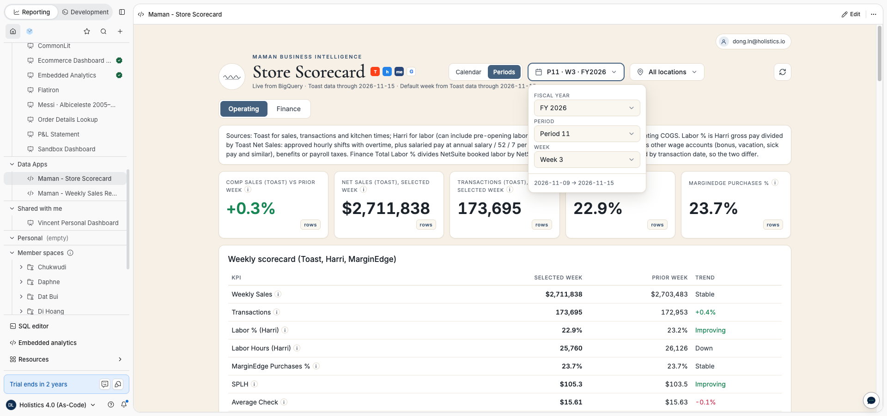
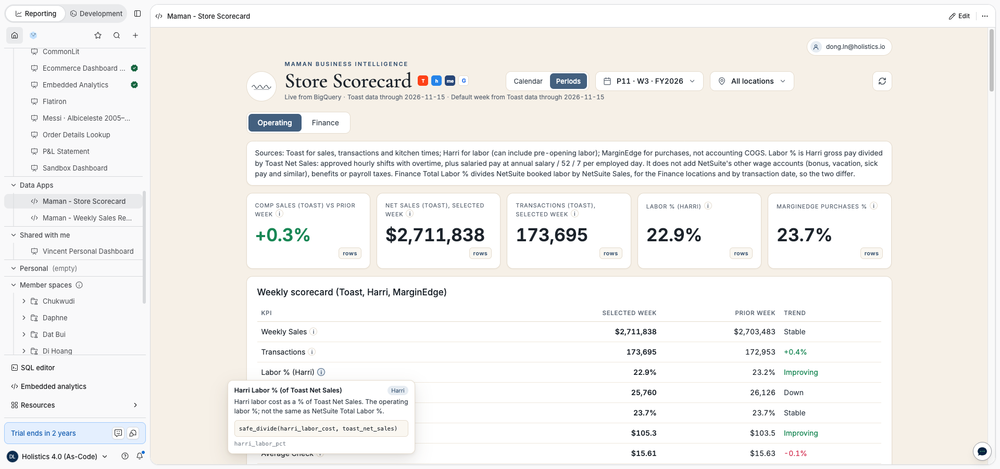
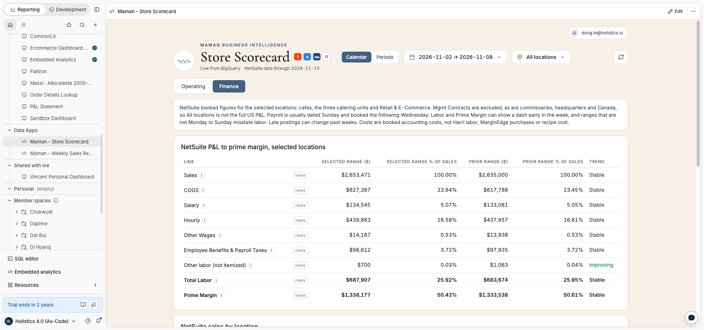
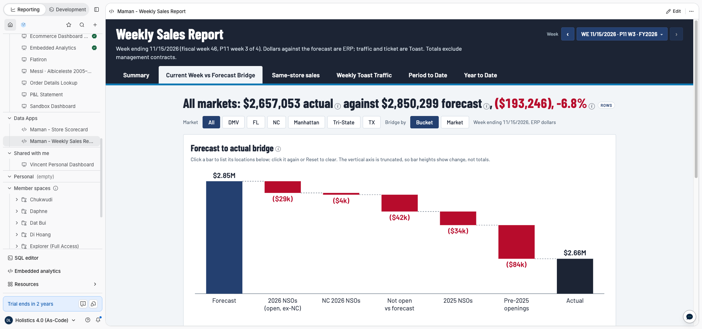
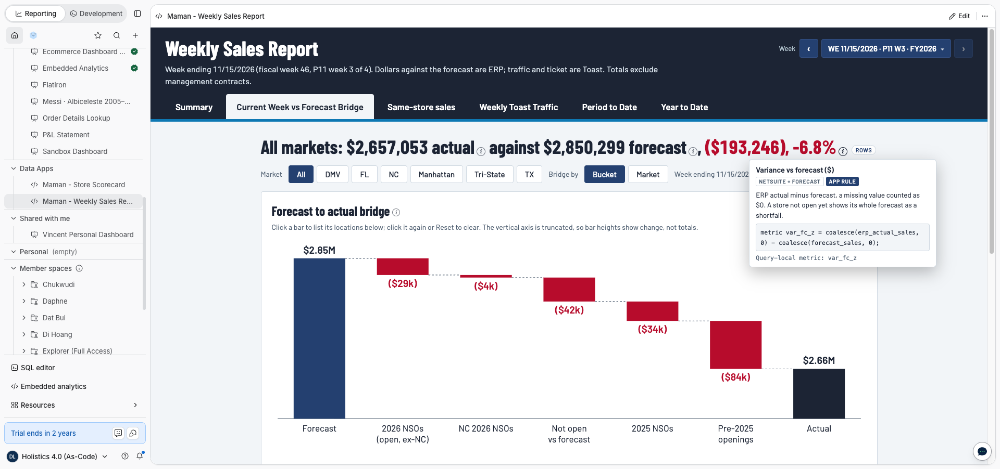
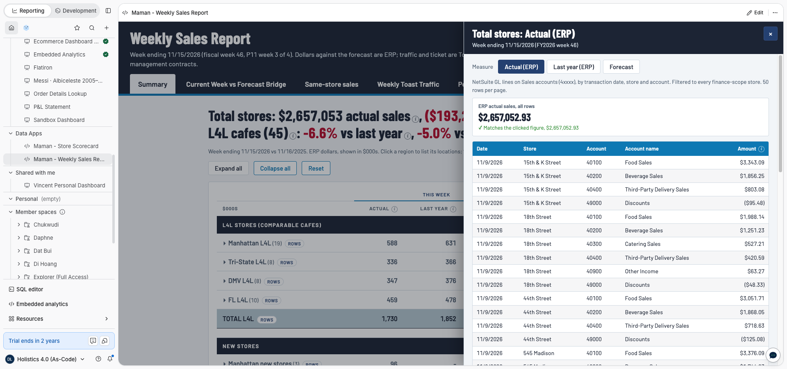
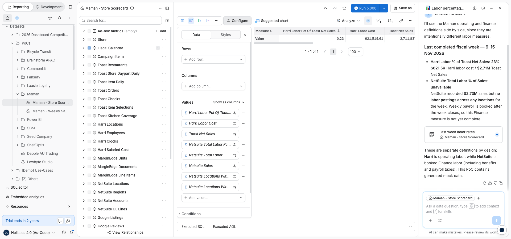

# Maman demo guide

Walkthrough of the two data apps, the dataset and Holistics AI, with a screenshot per step.

## About the data

All numbers are generated mock data, not Maman's figures.

- **Tables:** same names and grain as the curated tables Maman described, rebuilt in our BigQuery.
- **Columns:** inferred from their KPI definitions and their two reports, since Maman shared table names only.
- **Values:** store names and opening dates follow Ryan's report; all amounts are generated.

## Links

- [Store Scorecard app](https://demo4.holistics.io/apps/1106-maman-store-scorecard)
- [Weekly Sales Report app](https://demo4.holistics.io/apps/1107-maman-weekly-sales-report)
- [Maman - Store Scorecard dataset](https://demo4.holistics.io/datasets/80184)
- [Maman - Weekly Sales dataset](https://demo4.holistics.io/datasets/80185)
- In the sidebar: Reporting → Data Apps → Maman, and Datasets → PoCs → Maman

Current limits:

- **The apps do not link to the dataset yet.** Keep the dataset open in a second tab.
- **Ask AI is not in data apps yet (coming soon).** Run Ask AI from the dataset page.

Open both apps about 5 minutes before the call. A cold load takes 30 to 50 seconds.

## 1. Store Scorecard

Maman's Store Scorecard as a data app. Operating and Finance are separate tabs because they use different source systems and definitions.

### 1.1 Operating tab

Opens on the latest fiscal week: KPI tiles, then the weekly scorecard, sales drivers, top sellers and Google reviews.

Talk track: "Every number comes from the shared metrics in the semantic layer, labelled with its source: Toast for sales, Harri for labor, MarginEdge for purchases."

### 1.2 Periods: pick a fiscal week or period

With **Periods** selected, click the date button and pick fiscal year, period and week (4-4-5 calendar). The comparison column shows the prior week or period.

### 1.3 Calendar: pick any date range

Select **Calendar**, click the date button, and pick a preset or a custom range, then **Apply**. The comparison is the same number of days just before.

### 1.4 Locations

Click **All locations** to search, **Check all** or pick stores. Both tabs follow the selection.

### 1.5 Metric definition: hover the (i)

Hover the **(i)** next to any tile or KPI. The tooltip shows:

- the metric name and its source system
- a one-line definition, the same text as in the dataset
- the AQL formula Holistics runs

Show **Labor % (Harri)**: it states it is not the same as NetSuite Total Labor %.

### 1.6 Underlying data: click "rows"

Click **rows** on a tile, location row or P&L line. A panel lists the rows behind the number, 50 at a time, with a green tick when they add up to it.

Talk track: "You can always check a number against its rows, and it ties to the cent."

### 1.7 Finance tab

NetSuite booked P&L down to Prime Margin, in dollars and % of sales, for the selected and prior range. Every line has (i) and **rows**.

The latest week has no payroll booked yet (it books the Wednesday after), so labor lines show a dash. For a full P&L, use Calendar 2 to 8 November 2026, as in the screenshot.

## 2. Weekly Sales Report

Ryan's weekly sales report as a data app, with six tabs. Change week with the arrows at the top right. Period to date and Year to date load in the background.

### 2.1 Summary

Sales vs forecast and last year, by L4L cafes, new stores, catering and retail. Click a region to expand its stores. Every figure has (i) and **ROWS**.

### 2.2 Current week vs forecast bridge

Waterfall from forecast to actual by store bucket. Click a bar to list its locations; filter with the Market chips.

### 2.3 Definitions: dataset metric vs app rule

Hover any (i). **APP RULE** marks logic the app adds on top of the dataset, such as variances, L4L and bridge buckets, as opposed to shared dataset metrics.

### 2.4 Underlying data: click "ROWS"

Click **ROWS** next to a figure to list the NetSuite GL lines behind it. Switch between Actual, Last year and Forecast at the top.

Click only after the page finishes loading; during background loading the panel can take up to 30 seconds.

## 3. The dataset

Open [Maman - Store Scorecard](https://demo4.holistics.io/datasets/80184) in a second tab.

The field list shows metric folders first (red boxes), then the raw tables:

- **Operating folders:** Operating Sales Traffic Toast, Operating Labor Harri, Operating Purchases Marginedge, Operating Kitchen Toast, Operating Sales Drivers Toast, Operating Items Toast, Operating Google Reviews
- **Finance folders:** Finance Pnl Dollars Netsuite, Finance Pnl Pct Of Sales Netsuite, Finance Coverage Netsuite Vs Toast
- **Tables:** Store, Fiscal Calendar, then each source system's tables

The pairs Maman wants kept apart sit in different folders: Toast Net Sales vs NetSuite Sales, Harri labor vs NetSuite labor, MarginEdge purchases vs NetSuite COGS. The (i) next to a metric shows the same definition as in the apps.

The Weekly Sales dataset has folders for ERP sales, forecast, and Toast traffic this year and last year.

## 4. Ask AI

### 4.1 Open Ask AI

The Ask AI panel is on the right of the dataset page; if closed, click the AI face icon in the toolbar. The dataset is already in context.

### 4.2 Simple question: labor

Type: **What was our labor % last week?**

About 30 seconds. It shows both definitions: Harri labor 23% of Toast Net Sales, and NetSuite labor not yet available because payroll books after the week closes.

Talk track: "The AI knows Maman's own rules: it names the source of every number and never merges the two labor definitions."

### 4.3 Follow-up: why sales differ

Type: **Why are Toast sales and NetSuite sales different last week?**

About 1 to 2 minutes, as it checks the gap store by store. It finds the main driver (Retail and E-Commerce has NetSuite sales but no Toast sales) and explains that the two differ by design.

Other prompts:

- What does this dataset contain?
- Give me the one official labor % for P10 for the CFO. (It shows both and says the choice is still open.)
- What is the difference between average check and average ticket?

## If something goes wrong

- **"Couldn't load" with Retry:** click Retry; it re-runs only that section.
- **Page dimmed, nothing opens:** reload.
- **A number looks odd:** it is mock data; click **rows** to show what is behind it.
